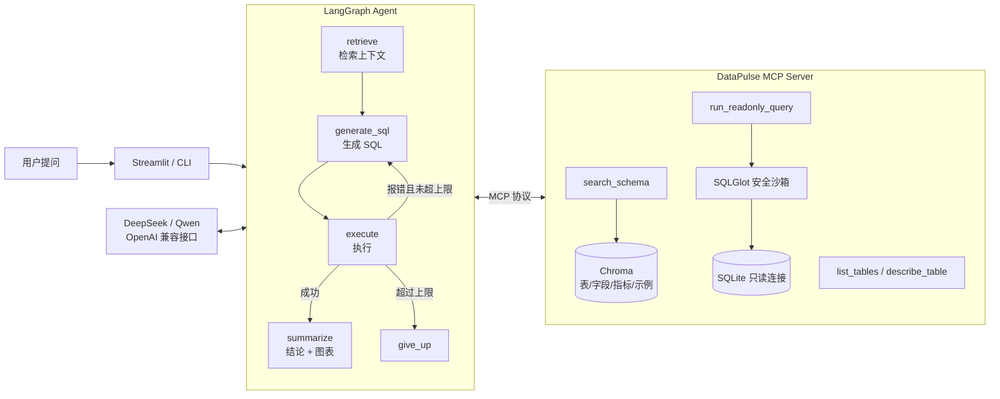

# DataPulse-Agent

**基于 MCP 协议的智能问数与报表分析助手**：用自然语言问经营数据，自动生成 SQL、安全执行、出图并给出结论。

[](https://github.com/habiball343/DataPulse-Agent/actions/workflows/ci.yml)


> 示例场景：物流公司的 TMS 经营报表（线路毛利、车队准点率、客户月结账单）。
> 仓库自带的演示数据库由脚本随机生成，**全部为虚构数据**。

```
问：上个月各线路的毛利排行
 ├─ Schema Linking   命中 waybills + routes，指标口径「毛利」，3 条相似参考 SQL
 ├─ 生成 SQL（第 1 次） SUM(w.profit) ...        ✗ no such column: w.profit
 ├─ 自动修正（第 2 次） SUM(w.freight_revenue - w.transport_cost) ...   ✓
 ├─ 安全改写           追加 LIMIT 200，只读执行，2.1 ms
 └─ 输出               结论 + 横向柱状图 + 明细表
```

## 功能亮点

| 能力 | 做法 | 代码 |
|---|---|---|
| **标准 MCP Server** | 查库能力封装为 4 个 MCP 工具 + 1 个资源，Agent 只通过协议调用；同一个 Server 可直接挂到 Claude Desktop / Cursor / Cherry Studio | [`mcp_server.py`](src/datapulse/mcp_server.py) |
| **Schema Linking** | 「关键词 + 枚举值精确匹配」与「向量检索」两层召回，按表聚合打分，沿外键自动补桥接表，再对宽表做列剪枝 | [`schema_index.py`](src/datapulse/schema_index.py) |
| **语义层** | 为表、字段补中文说明和同义词，统一定义毛利率、准点率、回款率等指标口径，避免模型自创算法 | [`catalog.yaml`](src/datapulse/resources/catalog.yaml) |
| **动态 Few-Shot** | 「业务问题 - 标准 SQL」示例存入 Chroma，按相似度取 Top-K 注入提示词 | [`few_shots.yaml`](src/datapulse/resources/few_shots.yaml) |
| **SQL 安全沙箱** | SQLGlot 解析语法树：只放行单条 SELECT，拦截 DROP / DELETE / UPDATE / PRAGMA / ATTACH 等，表白名单，自动注入 / 收紧 LIMIT；数据库连接本身只读，双重保护 | [`sql_guard.py`](src/datapulse/sql_guard.py) · [`db.py`](src/datapulse/db.py) |
| **执行反馈自修复** | 执行报错（字段写错、语法不兼容、违反只读规则）时，把失败 SQL 和报错原文回传模型定向重写，最多 3 轮；仍失败则如实说明，不编造答案 | [`agent/graph.py`](src/datapulse/agent/graph.py) |
| **自动图表** | 按结果形状规则推荐折线 / 柱状 / 饼图，生成 ECharts 配置；量纲差异大时自动启用双 Y 轴 | [`charts.py`](src/datapulse/charts.py) |
| **离线评测** | 18 道题的标准答案集，按执行结果比对计算准确率，支持关闭自修复做消融对比 | [`eval/`](eval) |

## 架构



## 快速开始

```bash
git clone https://github.com/habiball343/DataPulse-Agent.git
cd DataPulse-Agent
python -m venv .venv && source .venv/bin/activate   # Windows: .venv\Scripts\activate
pip install -e ".[ui,dev]"

cp .env.example .env        # 填入 DATAPULSE_LLM_API_KEY（DeepSeek / 通义千问均可）
datapulse init-db           # 生成演示数据库（首次运行也会自动生成）

streamlit run app/streamlit_app.py
```

不想配 API Key 也能先跑起来看看：

```bash
pytest -q                                   # 65 个离线测试，用脚本化的假模型跑通完整 Agent 流程
datapulse schema "外协车队上个月的准点率"      # 只看 Schema Linking 检索到了什么
```

命令行问数：

```bash
datapulse ask "毛利率最低的 5 条线路"
datapulse ask "各行业客户的货量" --stdio     # 以子进程方式启动 MCP Server，演示跨进程解耦
```

## 接入 Claude Desktop 等 MCP 客户端

Server 是标准的 stdio MCP 服务，在客户端配置里加上：

```json
{
  "mcpServers": {
    "datapulse": {
      "command": "datapulse-mcp",
      "env": { "DATAPULSE_DB_PATH": "/绝对路径/DataPulse-Agent/data/tms_demo.db" }
    }
  }
}
```

之后在客户端里直接问「上个月哪条线路最赚钱」，客户端的模型会自己调用 `search_schema` 和 `run_readonly_query`。

| 工具 | 作用 |
|---|---|
| `list_tables` | 列出业务表、中文说明、行数 |
| `describe_table` | 单表完整结构：字段、类型、外键、枚举取值 |
| `search_schema` | 按问题返回剪枝后的表结构、指标口径、参考 SQL、数据日期范围 |
| `run_readonly_query` | 安全检查后只读执行，返回列、行、是否截断、耗时 |
| 资源 `schema://catalog` | 全库结构与指标口径（Markdown） |

## 设计取舍

**为什么把查库做成独立的 MCP Server？**
Agent 只认识「工具」，不关心背后是 SQLite、MySQL 还是数仓。换数据源只改 Server；安全检查放在 Server 侧，任何客户端都绕不过去；同一个 Server 还能直接给 Claude Desktop 用。

**为什么用语法树而不是正则做 SQL 检查？**
正则匹配的是字面文本：`SELECT 1; /* */ DELETE ...` 这类拼接、注释、大小写变化很容易绕过，而列名里带 `update_time` 又会被误杀。解析成语法树后判断的是「这条语句实际在做什么」。数据库连接再以只读模式打开，作为第二道防线。

**为什么 Schema Linking 要两层召回？**
向量检索擅长同义改写（「赚了多少钱」→ 毛利），但对「9.6米厢车」「外协车队」这类精确取值不敏感；关键词与枚举值匹配正好相反。两者打分合并，再强制带上命中指标依赖的表和字段，避免「找到了指标却把计算要用的列剪掉了」。

**为什么默认用哈希向量而不是 BGE？**
让项目克隆下来零配置就能跑测试和 CI。哈希向量对「字段说明」这种短文本已经够用；需要更好的语义效果时在 `.env` 里把 `DATAPULSE_EMBEDDING_PROVIDER` 改成 `openai`，接任意 OpenAI 兼容的 Embedding 接口（如 SiliconFlow 的 `BAAI/bge-m3`），其余代码不用改。

**为什么图表不让大模型生成？**
图表类型由数据形状决定（时间序列→折线，类别对比→柱状，占比→饼图），规则足以覆盖且结果稳定；大模型只负责它擅长的部分：写 SQL 和用自然语言解读结果。

## 评测

```bash
python eval/run_eval.py              # 完整流程
python eval/run_eval.py --no-repair  # 关闭自修复，对比自修复带来的提升
```

评测集 [`eval/questions.yaml`](eval/questions.yaml) 覆盖单表、多表 JOIN、指标口径、相对时间、子查询、HAVING 等题型，且与 Few-Shot 示例不重复（有测试保证）。
判定标准为**执行准确率**：分别执行模型 SQL 和标准 SQL，行数一致且标准答案的每一列都能在模型结果中找到数值一致的列即判对（允许多返回辅助列、浮点误差 0.5%）。
每次运行的明细保存在 `eval/results/`，可用来对比不同模型、提示词和检索策略。

## 项目结构

```
src/datapulse/
├── mcp_server.py        MCP Server：工具定义与业务实现
├── sql_guard.py         SQLGlot 语法树安全检查
├── db.py                只读连接、超时控制、表结构探查
├── schema_index.py      Schema Linking 与 Few-Shot 检索（Chroma）
├── embeddings.py        哈希向量 / OpenAI 兼容 Embedding
├── tool_client.py       Agent 侧 MCP 客户端（进程内 / stdio）
├── agent/
│   ├── graph.py         LangGraph 状态图：检索 → 生成 → 执行 → 自修复 → 总结
│   └── prompts.py       提示词模板
├── charts.py            ECharts 图表推荐
├── llm.py               OpenAI 兼容模型封装 + 测试用假模型
├── evaluation.py        执行准确率判定
├── demo_data.py         演示数据生成
├── cli.py               命令行入口
└── resources/
    ├── catalog.yaml     语义层：表 / 字段说明、指标口径
    └── few_shots.yaml   业务问题 - 标准 SQL 示例
app/streamlit_app.py     Web 界面
eval/                    评测集与评测脚本
tests/                   离线单元测试与集成测试
```

## 路线图

- [ ] 多轮对话：支持「那 10 月呢？」这类基于上一轮的追问
- [ ] 接入 MySQL：SQLGlot 方言切换 + 只读账号
- [ ] 结果缓存：相同问题 + 相同数据版本直接返回
- [ ] Streamable HTTP 传输，支持远程部署 MCP Server
- [ ] 持续扩充公开脱敏评测集（内部业务库完整评测集 80+ 题，当前开源仓库精选 18 道典型多表关联与指标口径基准题）

## License

MIT
